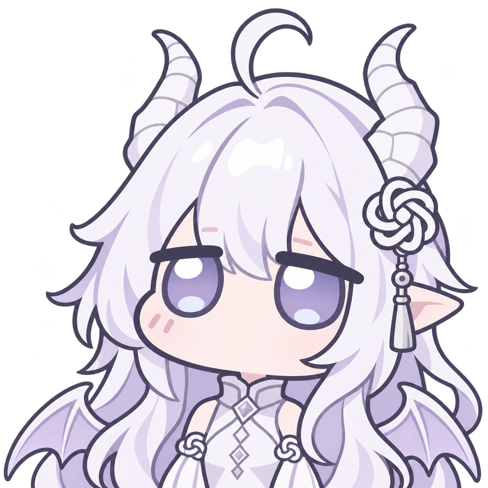
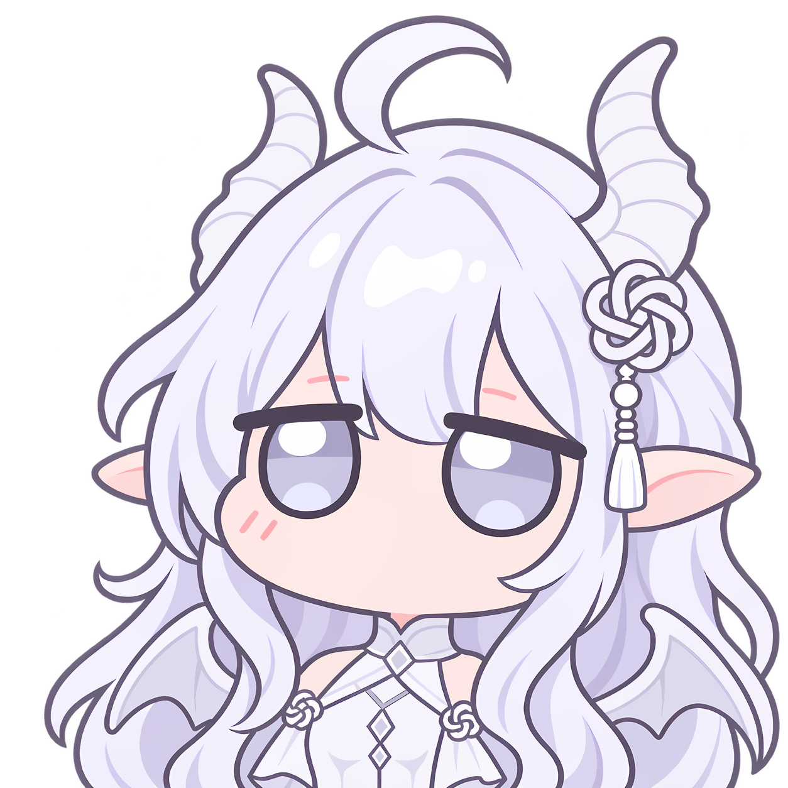

# Custom GPT dragon character / GPT 小龙娘定制角色

## Versions / 版本

| Version / 版本 | Image / 图片 | Suggested name / 建议角色名 |
| --- | --- | --- |
| Original / 第一版 | [gpt-dragon-chibi-original.png](../assets/gpt-dragon-chibi-original.png) | GPT 小龙娘 |
| Selected palette-adjusted version / 最终选定调色版 | [gpt-dragon-chibi-custom.png](../assets/gpt-dragon-chibi-custom.png) | GPT 小龙娘·调色版 |

### Original / 第一版

### Palette-adjusted version / 调色版

## Import / 导入

In the whale menu, open Settings → Appearance & Position → Character → Import. Select either image from the table above and give it the corresponding name. To keep both, import the two files separately. Importing adds a new character; existing characters remain available.

在小鲸鱼菜单中打开 设置 → 外观与位置 → 角色 → 导入，选择上表中任意一张图片并填写对应名称。想保留两个版本，可以分别导入。导入会新增角色，已有角色仍可切换使用。

## Source and processing / 来源与处理

- Character design reference: GPT dragon girl by ZipZipPipe, as referenced on https://genderswapai.com/zh-CN/ai-gijinka/gpt .
- Chibi style reference: the whale character included with the original widget; original character and adaptation attribution remains in the repository's existing notices.
- Both chibi images were made with the built-in image generation tool. The original is the first generated portrait, preserved without denoising. The selected palette-adjusted version was iteratively edited and processed with gpt-anime-denoise v1.5.0 (ESRGAN 60% + L0 0.001).
- PNG, 1254 × 1254, transparent background. Personal role-library indexes and account settings are not included.

角色设计参考 ZipZipPipe 的 GPT 龙娘；Q 版画风参考原挂件小鲸鱼。第一版保留最初生成的原图，未经去噪；最终选定的调色版经过多轮调整和 gpt-anime-denoise 去噪。两版均为 1254 × 1254 透明 PNG，不含个人角色库索引或账户设置。

The code's MIT license does not grant additional rights to the referenced character design or source artwork. This attribution records provenance; it is not a separate permission or license grant from the original artist.

代码的 MIT 许可不扩大原角色设计与参考画作的权利。本说明记录来源，不代表原作者另行授予的许可。
